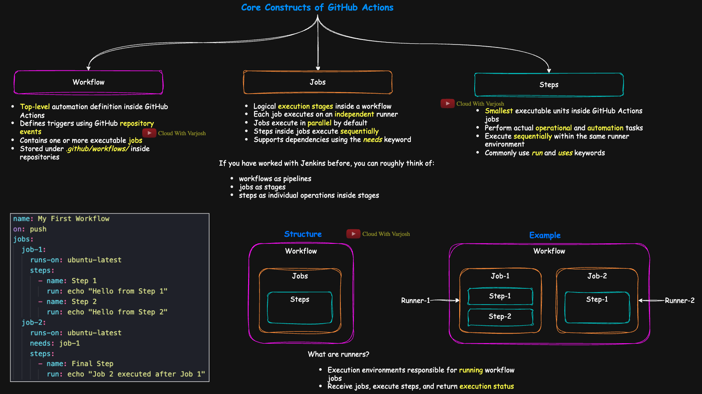

# Learn GitHub Actions

A practical guide to understanding GitHub Actions, CI/CD automation, and workflow orchestration in GitHub repositories.



## Overview

GitHub Actions is GitHub’s built-in automation platform for running workflows based on repository events. It allows developers and DevOps engineers to automate tasks such as:

- Continuous Integration (CI)
- Continuous Delivery (CD)
- Testing and linting
- Deployment to cloud platforms
- Issue and pull request automation
- Scheduled and trigger-based tasks

## Core Concepts

### 1. Workflow
A workflow is the main automation definition in GitHub Actions. It tells GitHub:

- which events should trigger the automation
- which jobs should run
- the order of execution and dependencies
- required permissions and environment settings
- the overall CI/CD behavior

Workflows are stored as YAML files in:

```bash
.github/workflows/
```

Example:

```bash
.github/workflows/ci.yml
```

A repository can contain multiple workflows, each serving a different purpose such as testing, deployment, or release management.

### 2. Job
A job is a set of steps that run in the same runner environment. Jobs can run in parallel or depend on one another.

### 3. Step
A step is an individual task within a job, such as:

- checking out code
- installing dependencies
- running tests
- building artifacts
- deploying an app

### 4. Runner
A runner is the machine that executes the workflow. GitHub provides hosted runners, and you can also use self-hosted runners.

### 5. Events
Workflows are triggered by GitHub events, such as:

- push
- pull_request
- workflow_dispatch
- schedule
- release

### 6. Actions
Actions are reusable units of automation. They can be official GitHub actions or custom actions created within a project.

## Important Keywords in GitHub Actions

### `run`
The `run` keyword is used to execute shell commands directly on the runner. It is commonly used for commands like installing packages, building projects, running tests, or invoking scripts.

Use `run` when you want to execute a command in the terminal of the runner.

```yaml
steps:
  - name: Install dependencies
    run: npm install

  - name: Run unit tests
    run: npm test
```

Key points:

- `run` executes commands in a shell
- it is useful for custom logic
- it is mainly used for scripts and project commands
- the command runs on the machine selected by `runs-on`

Example with multiple commands:

```yaml
- name: Build application
  run: |
    echo "Starting build"
    npm install
    npm run build
```

### `uses`
The `uses` keyword is used to call a reusable action from a GitHub repository, marketplace, or local action. It is typically used for standard tasks such as checking out code, setting up a language runtime, or deploying applications.

Use `uses` when you want to reuse an already built solution instead of writing the logic yourself.

```yaml
steps:
  - name: Checkout code
    uses: actions/checkout@v4

  - name: Setup Node.js
    uses: actions/setup-node@v4
    with:
      node-version: 20
```

Key points:

- `uses` references an action
- it is used for reusable logic
- it often includes a version such as `@v4`
- it may accept inputs through the `with` block

### Difference between `run` and `uses`

- `run` executes a command directly in the shell
- `uses` calls an existing action from a source such as GitHub Marketplace or another repository

A simple rule:

- use `run` for commands you write yourself
- use `uses` for prebuilt actions that perform a task for you

## Example Workflow

```yaml
name: CI

on:
  push:
    branches: [main]
  pull_request:
    branches: [main]

jobs:
  build:
    runs-on: ubuntu-latest

    steps:
      - name: Checkout repository
        uses: actions/checkout@v4

      - name: Set up Node.js
        uses: actions/setup-node@v4
        with:
          node-version: 20

      - name: Install dependencies
        run: npm install

      - name: Run tests
        run: npm test
```

This example shows the basic flow of a CI workflow:

1. trigger on push or pull request
2. check out the repository
3. set up the environment
4. install dependencies
5. run tests

## Repository Structure

```text
Learn-Actions/
├── README.md
├── CI_CD/
├── Triggers/
└── .github/workflows/
```

- `README.md` contains the main overview and learning notes
- `CI_CD/` is intended for CI/CD examples and deployment workflow projects
- `Triggers/` is intended for event-based trigger examples
- `.github/workflows/` stores the actual GitHub Actions YAML workflow files

## Why GitHub Actions Matter

GitHub Actions helps teams automate repetitive development tasks and improve software delivery speed. It reduces manual work, ensures consistency, and enables reliable deployment pipelines.

## Suggested Learning Path

1. Understand basic workflow structure
2. Practice triggers like push and pull request
3. Learn jobs, steps, and runners
4. Build simple CI pipelines
5. Add deployment workflows for staging or production
6. Explore secrets, environments, and approvals

## Next Steps

Use this repository as a learning workspace to explore:

- CI/CD workflows
- event-based automation
- release pipelines
- GitHub Actions best practices

This project is designed to help you become more comfortable with automation using GitHub Actions.


